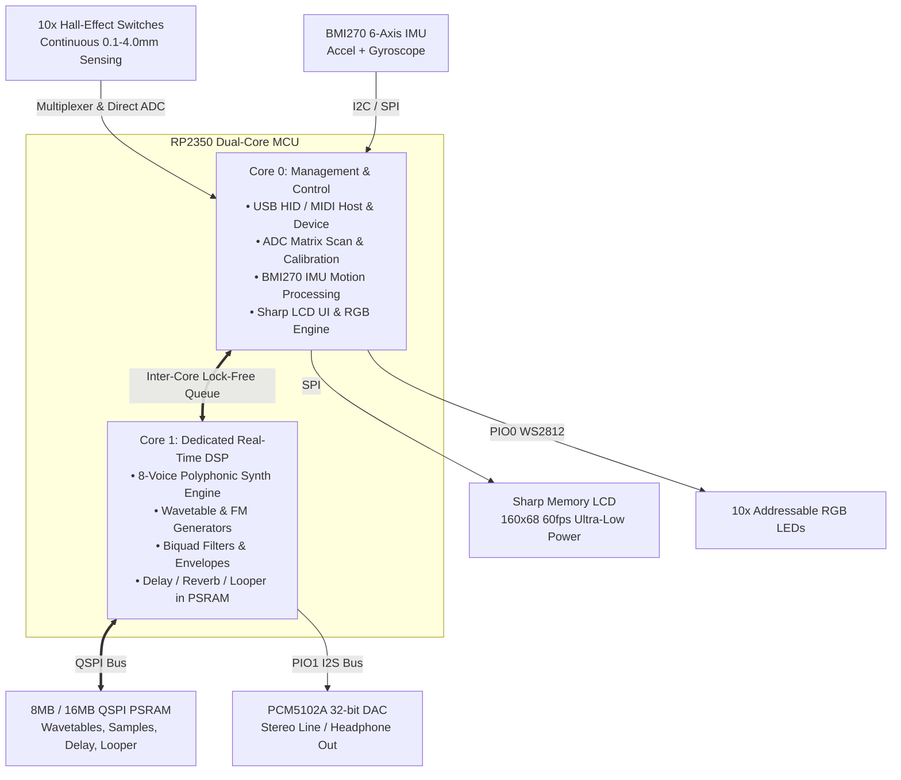

# Magneteno — Expressive Hall-Effect Pocket Synthesizer & MPE Controller

**Magneteno** is a hybrid micro-instrument combining an ultra-expressive **10-key Hall-effect analog keyboard**, a dedicated **RP2350 dual-core audio DSP engine**, high-fidelity **I2S stereo DAC**, **QSPI PSRAM** sample/delay memory, a **BMI270 6-axis spatial IMU**, a sunlight-readable **Sharp Memory LCD**, and **per-key addressable RGB LEDs**.

It operates both as a **standalone portable synthesizer/groovebox** and as an **advanced MPE (MIDI Polyphonic Expression) USB controller**.

---

## Hardware Architecture & Component Roles



### Hardware Component Roles Summary

| Component | Synthesizer Role |
| :--- | :--- |
| **10x Hall-Effect Switches** | Continuous analog control (0.1–4.0 mm) and MPE:<br/>• **Velocity**: strike speed calculated via $dx/dt$;<br/>• **Polyphonic Aftertouch**: per-voice VCF opening and saturation on deep press;<br/>• **Timbre Morphing**: travel depth scans wavetables (Sine $\to$ Saw $\to$ Square);<br/>• **Rapid Trigger**: rapid retriggering without returning to the top;<br/>• **Keys 9 & 10** (thumbs): direct ADC — pitch bend strips, sustain, or octave shift. |
| **PCM5102A I2S DAC** | High-fidelity stereo output (32-bit, 112 dB SNR):<br/>• Direct 3.5 mm headphone or monitor/mixer connection;<br/>• Stereo voice panning, stereo delay, and algorithmic reverb;<br/>• Synthesis isolated on RP2350 Core 1 — zero jitter and zero clicks. |
| **QSPI PSRAM (8/16 MB)** | Memory for intensive audio and spatial FX:<br/>• Storage for large multi-cycle wavetables (Serum/Vital format);<br/>• Drum and acoustic PCM samples;<br/>• Buffer for stereo tape delay (up to 30s) and FDN reverb;<br/>• **Live Sound-on-Sound Looper**: real-time phrase recording, looping, and soloing. |
| **BMI270 6-Axis IMU** | Spatial motion gestures:<br/>• **Roll** (left/right tilt): guitar-style vibrato or smooth pitch bend;<br/>• **Pitch** (forward/backward tilt): master Low-Pass filter cutoff modulation;<br/>• **Shake**: instant glitch, drum roll, or delay freeze;<br/>• **Tap Tempo**: double-tap chassis sets sequencer BPM. |
| **Sharp Memory LCD** | Ultra-fast low-power display (160x68):<br/>• Real-time audio oscilloscope (60 fps without blur);<br/>• 10 vertical gauges showing exact physical key depth in real time;<br/>• Graphical ADSR envelope curve and filter frequency curve;<br/>• Preset, scale/key, BPM, and octave status. |
| **10x RGB LEDs** | Intuitive visual feedback:<br/>• **Scale illumination**: root note blue, chord tones green, out-of-scale notes off (foolproof playing);<br/>• **Travel visualizer**: cyan $\to$ amber/red transition into aftertouch zone;<br/>• **Playhead**: running light showing active step in 8/16/32-step sequence;<br/>• Active voice monitor with envelope release fade. |

---

### 1. 10x Hall-Effect Analog Switches (Keys 1..10)
Unlike traditional binary on/off mechanical switches, Magneteno uses **linear Hall-effect sensors** (multiplexed via `SN74LV4051A` + dedicated direct ADC lines) to measure continuous key position from **0.0 mm to 4.0 mm** of physical travel with sub-millimeter precision.

* **Continuous MPE Modulation**:
  * **Strike Velocity**: Measured in real time as the key descent speed ($v = \frac{dx}{dt}$) over the initial stroke (0.3–1.5 mm). ADC sample timing is mapped to standard MIDI `1..127` velocity via selectable response curves (Linear, Logarithmic, Exponential).
  * **Polyphonic Aftertouch**: The travel range from actuation threshold (1.5 mm) down to the mechanical bottom (4.0 mm) is continuously sampled as per-finger polyphonic aftertouch:
    * **Destination Selection**: VCF Cutoff, Resonance, Saturation/Drive, LFO Depth (vibrato/tremolo), Wavetable Position, Pitch Bend, or FX Send.
    * **Modulation Depth**: Bipolar range `-100% ... 0 ... +100%`, allowing aftertouch to either open/brighten or softly damp/muffle the sound.
  * **Timbre Morphing**: Travel depth can dynamically morph waveforms (e.g. pure Sine at 1mm $\to$ Warm Saw at 2.5mm $\to$ Aggressive Pulse/Square at 4mm).
* **Rapid Trigger**: An indispensable expressive feature for synthesizers:
  * Traditional keyboards require releasing a key past a fixed reset point (1.5–2.0 mm above the bottom) before a note can be retriggered.
  * With **Rapid Trigger**, the reset point tracks finger motion dynamically: lifting the key by as little as **0.1–0.2 mm anywhere in its stroke** resets the note trigger instantly.
  * **Musical Advantages for Synths**:
    * Ultra-fast tremolo and picked runs (mandolin, flamenco guitar, bowed strings).
    * Rapid chiptune arpeggios performed manually with zero lag.
    * Machine-gun drum rolls and trap hi-hat rolls (e.g. 808 rolls).
    * Re-articulating envelopes without breaking sustain or generating clicks.
* **Multi-Stage Actuation**:
  * *Top zone (0.5 – 1.5 mm)*: Primary melodic voice.
  * *Bottom zone (2.5 – 4.0 mm)*: Activates an octave sub-oscillator or noise layer.
* **Thumb Keys (Key 9 & Key 10)**:
  * Direct high-speed ADC lines (`ADC2` on GPIO28, `ADC1` on GPIO27).
  * Configured as expressive pitch bend strips, octave shifting paddles, sustain pedals, or chord memory modifiers.

---

### 2. PCM5102A 32-bit I2S Stereo DAC
Dedicated high-fidelity digital-to-analog converter connected via PIO-driven I2S (`BCK` on GPIO6, `DATA` on GPIO7, `LRCK` on GPIO8).

* **Direct Audio Output**: Drives 3.5mm headphones or line-level inputs (studio monitors, audio interfaces, portable speakers) with 112 dB SNR.
* **Stereo Voice Panning**: Voices can be dynamically panned across the stereo field based on key pitch, LFO modulation, or physical device tilt.
* **Dedicated Core 1 DSP Execution**: Audio synthesis runs entirely on RP2350's **Core 1** inside RAM (`__not_in_flash_func`), eliminating any audio dropouts, click artifacts, or jitter caused by USB or flash read operations.

---

### 3. QSPI PSRAM (8MB / 16MB)
High-speed external pseudo-SRAM connected to the RP2350 QSPI interface.

* **Massive Wavetable Banks**: Stores high-resolution multi-cycle wavetables (compatible with Serum / Vital format) for morphing digital synthesis.
* **PCM Sample Playback**: Enables realistic drum kits, acoustic instruments, and field recordings with zero latency.
* **Time-Based FX Memory**:
  * **Stereo Delay**: Up to 30 seconds of high-fidelity stereo tape delay with feedback and saturation.
  * **Algorithmic Reverb**: High-density Feedback Delay Network (FDN) reverb buffers for lush ambient spaces.
* **Live Sound-on-Sound Looper**: Record audio phrases on the fly, loop them in the background, and perform live solos on top.

---

### 4. BMI270 6-Axis Motion IMU (Accelerometer + Gyroscope)
Integrated spatial sensing transforms the entire physical instrument into an expressive controller.

* **Tilt X (Roll - Left/Right)**:
  * Expressive guitar-style pitch vibrato or continuous pitch bend ($\pm 2$ to $\pm 12$ semitones).
* **Tilt Y (Pitch - Forward/Backward)**:
  * Modulates master Low-Pass Filter (LPF) cutoff frequency — tilt upward to open the filter, tilt downward for warm, muffled bass.
* **Shake & Impact Sensing**:
  * Quick shake triggers rhythmic roll, delay freeze, or instant FX drop.
* **Tap Tempo**:
  * Double-tapping the physical chassis automatically synchronizes sequencer BPM.

---

### 5. Sharp Memory LCD (LS011B7DH03 160x68 Monochrome)
Ultra-low-power reflective memory display (`MOSI` on GPIO11, `SCK` on GPIO10, `CS` on GPIO9).

* **Sunlight Readable & Instant Refresh**: Refreshes at 60 Hz without motion blur, ghosting, or backlight power drain.
* **Real-Time Visualizations**:
  * **Live Oscilloscope & Waveform Display**: Visualizes the combined audio output or active wavetable cycle.
  * **Analog Travel Depth Gauges**: 10 vertical bar meters showing exact physical key press depths in real time.
  * **Envelope & Filter Visualizer**: Graphical ADSR curve and filter cutoff frequency curve.
  * **Status & Patch Information**: Active preset name, scale/key, BPM, octave, and battery indicator.

---

### 6. 10x Addressable RGB LEDs (WS2812)
One ultra-bright RGB LED positioned beneath each switch (`GPIO12`).

* **Scale & Key Illumination**: Highlights root notes in Blue, chord intervals in Green, and pentatonic scales for foolproof soloing.
* **Dynamic Press Feedback**: Color transitions from subtle cyan $\to$ green $\to$ saturated amber/red as you press deeper into aftertouch.
* **Step Sequencer Playhead**: A running light indicates the active beat/step in 8- or 16-step sequence playback.
* **Voice Allocation Monitor**: Shows which voices are currently ringing, sustaining, or releasing.

---

### 7. CMSIS-DSP & RP2350 Math Engine (Core 1 DSP)
The RP2350 is built on **ARM Cortex-M33** cores featuring ARMv8-M DSP instruction extensions and a hardware **Single-Precision FPU**.

To deliver studio-grade audio quality and peak real-time performance, the synthesis engine utilizes **CMSIS-DSP** (`arm_math.h`):
* **Cascaded IIR Biquad Filters (`arm_biquad_cascade_df1_f32`)**: Low-pass, high-pass, band-pass, and notch filters execute entirely in float32, eliminating fixed-point quantization noise, overflow, and pops during rapid cutoff modulation.
* **Fast Real FFT (`arm_rfft_fast_f32`)**: 128/256-point real FFT computes in fractions of a millisecond, driving the live spectrum visualizer on the Sharp Memory LCD at a solid 60 fps.
* **Vectorized Mixing Operations (`arm_scale_f32`, `arm_mult_f32`, `arm_add_f32`)**: Parallel 8-channel track summation, gain ramping, and master soft-clipping with zero CPU loops in optimized assembly.
* **Fast Trigonometry (`arm_sin_f32`, `arm_cos_f32`, `arm_sqrt_f32`)**: High-precision table-interpolated oscillator and LFO generators with anti-aliasing.

---

---

## UI Navigation & Control Architecture

Magneteno uses a unified, muscle-memory friendly navigation model:
* **Simultaneous Press of Keys 9 + 10**: Instantly opens the **Global Menu** from any sub-mode.
* **Keys 1..8**: Parameter editors, slot selectors, sequencer steps, or musical notes.
* **Keys 9 & 10**: Navigation controls — page flipping (Prev/Next), bank/slot switching (Bank A/B), mode execution (Save/Load, Play/Stop).

| Column 1 | Column 2 | Column 3 | Column 4 | Column 5 |
| :---: | :---: | :---: | :---: | :---: |
| **[1] Oscillators**<br/>(OSC) | **[2] Filters**<br/>(VCF) | **[3] Envelopes**<br/>(EG / ADSR) | **[4] LFO**<br/>(Modulation) | |
| **[5] Advanced**<br/>(MPE, Legato) | **[6] Presets**<br/>(Save / Load) | **[7] Effects**<br/>(FX Engine) | **[8] 8-Ch. Mixer**<br/>(Mixer) | |
| | | | **[9] Piano Mode**<br/>(Piano Play) | **[10] Sequencer**<br/>(Step Seq) |

---

### Performance & Sequencer Modes

#### [9] Piano Performance Mode

| Column 1 | Column 2 | Column 3 | Column 4 | Column 5 |
| :---: | :---: | :---: | :---: | :---: |
| **[1] Note 1**<br/>(Degree I) | **[2] Note 2**<br/>(Degree II) | **[3] Note 3**<br/>(Degree III) | **[4] Note 4**<br/>(Degree IV) | |
| **[5] Note 5**<br/>(Degree V) | **[6] Note 6**<br/>(Degree VI) | **[7] Note 7**<br/>(Degree VII) | **[8] Note 8**<br/>(Octave / VIII) | |
| | | | **[9] Octave - / Pitch-**<br/>(Pitch / Oct Down) | **[10] Octave + / Pitch+**<br/>(Pitch Up / Hold) |

*Keys 1..8 continuously sense analog depth: providing Polyphonic Aftertouch and strike velocity.*

#### [10] Step Sequencer

32-step sequencer with 4 pages of 8 steps each, featuring per-track synth parameter profiles across all 8 tracks:

| Column 1 | Column 2 | Column 3 | Column 4 | Column 5 |
| :---: | :---: | :---: | :---: | :---: |
| **[1] Step 1 / 9 / 17 / 25**<br/>(Toggle / Mute) | **[2] Step 2 / 10 / 18 / 26**<br/>(Toggle / Mute) | **[3] Step 3 / 11 / 19 / 27**<br/>(Toggle / Mute) | **[4] Step 4 / 12 / 20 / 28**<br/>(Toggle / Mute) | |
| **[5] Step 5 / 13 / 21 / 29**<br/>(Toggle / Mute) | **[6] Step 6 / 14 / 22 / 30**<br/>(Toggle / Mute) | **[7] Step 7 / 15 / 23 / 31**<br/>(Toggle / Mute) | **[8] Step 8 / 16 / 24 / 32**<br/>(Toggle / Mute) | |
| | | | **[9] Rec / Step**<br/>(Step Record) | **[10] Pg. 1-4**<br/>(Page 1..4 / 32 St.) |

*Sequencer Controls:*
* **Single Tap [1..8]**: Toggle step active state (On / Mute).
* **Key [10]**: Cycle step pages (Page 1: 1–8, Page 2: 9–16, Page 3: 17–24, Page 4: 25–32).
* **Key [9]**: Toggle recording mode (Rec / Play).
* **Combo [9 + 10]**: Master Play / Stop transport toggle.
* **Combo [9 + 1..8] (Step Edit / Record Mode)**:
  * Because a 10-key device does not allow physically holding a step key while adjusting parameters, combo `9 + [1..8]` enters Step Edit Mode for that specific step (the step pulses on the LCD and RGB LED).
  * **Note Recording**: While in step edit mode, playing a note in **Piano Mode [9]** (or via USB MIDI) records pitch, strike velocity ($dx/dt$), and gate length.
  * **Parameter Locks (P-Locks)**: While editing a step, you can navigate to any synth menu `[1..7]` and modify parameters (VCF cutoff, envelopes, wavetable position, FX send) — any changed setting is automatically locked exclusively to that step!
  * Pressing `[9]` again exits step editing and returns to standard sequencer view.
* **Combo [9 + 10 + 1..8]**: Set pattern length / stop step on current page (from 1 to 32 steps), causing the sequencer to loop back to step 1 upon reaching this step.

---

### [8] 8-Channel Mixer & Looper

The mixer and the 8-track PSRAM audio looper are tightly integrated with the sequencer engine:
* Each track maintains its own independent synth parameters (oscillators, filters, envelopes, effects).
* **Key 10**: Toggles channel banks: **Bank A (Channels 1–4)** and **Bank B (Channels 5–8)**.
* **Key 9**: Toggles between **Mixer Faders Screen** and **Looper Control Screen**.
* Selecting a track (`[1..4]` in looper mode) automatically navigates to that track's **Step Sequencer** for recording and pattern editing.

#### Mixer Faders Screen

| Column 1 | Column 2 | Column 3 | Column 4 | Column 5 |
| :---: | :---: | :---: | :---: | :---: |
| **[1] Channel 1 / 5**<br/>Level `[+]` | **[2] Channel 2 / 6**<br/>Level `[+]` | **[3] Channel 3 / 7**<br/>Level `[+]` | **[4] Channel 4 / 8**<br/>Level `[+]` | |
| **[5] Channel 1 / 5**<br/>Level `[-]` | **[6] Channel 2 / 6**<br/>Level `[-]` | **[7] Channel 3 / 7**<br/>Level `[-]` | **[8] Channel 4 / 8**<br/>Level `[-]` | |
| | | | **[9] Looper View**<br/>(Rec / Play Screen) | **[10] Bank A / B**<br/>(Ch 1-4 / 5-8) |

*Holding keys cycles adjustment modes: Volume / Pan / Mute. Sharp LCD shows 8 VU meters.*

#### 8-Track Looper Control Screen

| Column 1 | Column 2 | Column 3 | Column 4 | Column 5 |
| :---: | :---: | :---: | :---: | :---: |
| **[1] Track 1 / 5**<br/>Seq / Rec | **[2] Track 2 / 6**<br/>Seq / Rec | **[3] Track 3 / 7**<br/>Seq / Rec | **[4] Track 4 / 8**<br/>Seq / Rec | |
| **[5] Track 1 / 5**<br/>Mute / Clear | **[6] Track 2 / 6**<br/>Mute / Clear | **[7] Track 3 / 7**<br/>Mute / Clear | **[8] Track 4 / 8**<br/>Mute / Clear | |
| | | | **[9] Mixer View**<br/>(Fader Screen) | **[10] Bank A / B**<br/>(Tr 1-4 / 5-8) |

#### Hybrid Synthesis & Looper Architecture:
* **Active Voice — Real-Time DSP**: The currently selected track is synthesized in real time on Core 1 with full polyphony, analog Hall MPE modulation, IMU spatial gestures, and step parameter locks.
* **Background Tracks — PSRAM Audio Loops**: Inactive/background parts play back as audio tracks (16-bit 44.1 kHz PCM) directly from PSRAM memory. Streaming 7 parallel audio tracks from PSRAM requires less than 0.6 MB/s (<5% of Dual SPI 50 MHz bandwidth) and practically 0% CPU overhead, reserving RP2350 computational power for the active lead synth and spatial FX.
* **PSRAM FX Memory**: In addition to loop audio, remaining PSRAM blocks are allocated for large circular delay lines (up to 30 seconds of tape delay with time modulation) and a dense Feedback Delay Network (FDN) algorithmic reverb.

#### Workflows & Integration:
1. **Track Select & Sequencer Entry**: Pressing `[1..4]` in looper mode opens the selected track's sequencer with its dedicated synth preset.
2. **Step Recording from Piano Mode & USB MIDI**: Combo `[9 + 1..8]` arms a step and switches to Piano Mode [9], allowing note, velocity, and duration input via analog Hall keys or external USB MIDI.
3. **Parameter Locks (P-Locks)**: Hold any step to lock custom synth parameters (e.g. open filter on step 5, change waveform on step 13).
4. **Sequence Bounce to Audio Loop**: A completed sequence can be bounced in one pass into an audio track in PSRAM, freeing the DSP polyphony engine for a new instrument.
5. **Sound-on-Sound Overdub**: Record additional layers on top of an active loop without erasing previous audio.
6. **Mute / Clear**: Keys 5..8 mute tracks, while a long hold clears the PSRAM audio buffer and resets the track's sequence.

---

### Synthesizer Editing Modes (Menu 1–7)

#### [1] Oscillators (OSC)

| Column 1 | Column 2 | Column 3 | Column 4 | Column 5 |
| :---: | :---: | :---: | :---: | :---: |
| **[1] OSC 1 Wave**<br/>(Sine/Saw/Square) | **[2] OSC 2 Wave**<br/>(Waveform) | **[3] OSC Mix**<br/>(Balance 1/2) | **[4] OSC 2 Coarse**<br/>(Pitch Semi) | |
| **[5] OSC 2 Detune**<br/>(Fine Unison) | **[6] Sub-Osc Level**<br/>(-1/-2 Oct) | **[7] Noise Level**<br/>(White / Pink) | **[8] Hard Sync**<br/>(Oscillator Sync) | |
| | | | **[9] Pg. 1: Basic**<br/>(Core controls) | **[10] Pg. 2: Wave**<br/>(PSRAM Tables) |

#### [2] Filters (VCF)

| Column 1 | Column 2 | Column 3 | Column 4 | Column 5 |
| :---: | :---: | :---: | :---: | :---: |
| **[1] Filter Type**<br/>(LP/BP/HP/Notch) | **[2] Cutoff Freq**<br/>(20Hz – 20kHz) | **[3] Resonance**<br/>(Q-Factor) | **[4] Filter Drive**<br/>(Saturation) | |
| **[5] Key Tracking**<br/>(0..100%) | **[6] Env Depth**<br/>(EG Mod) | **[7] Hall Depth**<br/>(Travel $\to$ Cutoff)| **[8] IMU Depth**<br/>(Tilt $\to$ Cutoff) | |
| | | | **[9] Profile A**<br/>(Analog Ladder) | **[10] Profile B**<br/>(Modern Clean) |

#### [3] Envelopes (Amp & Filter EG)

| Column 1 | Column 2 | Column 3 | Column 4 | Column 5 |
| :---: | :---: | :---: | :---: | :---: |
| **[1] Amp Attack**<br/>(Amplitude A) | **[2] Amp Decay**<br/>(Amplitude D) | **[3] Amp Sustain**<br/>(Amplitude S) | **[4] Amp Release**<br/>(Amplitude R) | |
| **[5] Filt Attack**<br/>(Filter A) | **[6] Filt Decay**<br/>(Filter D) | **[7] Filt Sustain**<br/>(Filter S) | **[8] Filt Release**<br/>(Filter R) | |
| | | | **[9] Page 1**<br/>(Amp / Filter EG) | **[10] Page 2**<br/>(Pitch / Mod EG) |

#### [4] LFO Modulation

| Column 1 | Column 2 | Column 3 | Column 4 | Column 5 |
| :---: | :---: | :---: | :---: | :---: |
| **[1] LFO 1 Shape**<br/>(Sine/Saw/S&H) | **[2] LFO 1 Rate**<br/>(0.1 – 50 Hz) | **[3] LFO 1 Target**<br/>(Pitch/VCF/Pan) | **[4] LFO 1 Depth**<br/>(Amount) | |
| **[5] LFO 2 Shape**<br/>(Waveform) | **[6] LFO 2 Rate**<br/>(Speed) | **[7] LFO 2 Target**<br/>(Destination) | **[8] LFO 2 Depth**<br/>(Amount) | |
| | | | **[9] Free Run**<br/>(Hz unlinked) | **[10] BPM Sync**<br/>(Tempo-locked) |

#### [5] Advanced (MPE & Expression Settings)

| Column 1 | Column 2 | Column 3 | Column 4 | Column 5 |
| :---: | :---: | :---: | :---: | :---: |
| **[1] Voice Mode**<br/>(Poly/Mono/Legato) | **[2] Portamento**<br/>(Glide Time) | **[3] AT Dest.**<br/>(VCF/Drive/LFO/WT) | **[4] AT Depth**<br/>(Depth -100..+100%) | |
| **[5] IMU Mapping**<br/>(Roll/Pitch/Shake) | **[6] Scale Mode**<br/>(Maj/Min/Penta) | **[7] Root Note**<br/>(C..B) | **[8] Rapid Trigger**<br/>(Reset 0.1-1.0mm) | |
| | | | **[9] Pg. 1: Play**<br/>(Expression) | **[10] Pg. 2: Calib**<br/>(ADC Calibration)|

#### [6] Presets (Save & Load)

| Column 1 | Column 2 | Column 3 | Column 4 | Column 5 |
| :---: | :---: | :---: | :---: | :---: |
| **[1] Slot 1**<br/>(Patch 1) | **[2] Slot 2**<br/>(Patch 2) | **[3] Slot 3**<br/>(Patch 3) | **[4] Slot 4**<br/>(Patch 4) | |
| **[5] Slot 5**<br/>(Patch 5) | **[6] Slot 6**<br/>(Patch 6) | **[7] Slot 7**<br/>(Patch 7) | **[8] Slot 8**<br/>(Patch 8) | |
| | | | **[9] Save Patch**<br/>(Save $\to$ Slot 1-8) | **[10] Load Patch**<br/>(Load $\leftarrow$ Slot 1-8)|

*Hold Keys 9+10 to reset current sound to Init Patch.*

#### [7] Effects (FX Engine)

| Column 1 | Column 2 | Column 3 | Column 4 | Column 5 |
| :---: | :---: | :---: | :---: | :---: |
| **[1] Delay Algo**<br/>(Tape/Ping-Pong) | **[2] Delay Time**<br/>(Sync Div / ms) | **[3] Feedback**<br/>(Delay Repeats) | **[4] Delay Mix**<br/>(Dry / Wet) | |
| **[5] Reverb Size**<br/>(Room in PSRAM) | **[6] Reverb Damp**<br/>(HF Damping) | **[7] Reverb Mix**<br/>(Dry / Wet) | **[8] Saturation**<br/>(Soft Limiter/Drive)| |
| | | | **[9] Pg. 1: Dly/Rev**<br/>(Delay & Reverb) | **[10] Pg. 2: Mod**<br/>(Chorus/Flanger) |

---

---

## Synthesizer Engines & Modes

| Engine | Description | Key Feature |
| :--- | :--- | :--- |
| **Virtual Analog** | Dual oscillators (Saw, Square, Triangle, Sine) with hard sync and sub-oscillator. | Continuous PWM and filter drive modulated by key depth. |
| **Wavetable Morph** | 256-sample interpolating wavetables loaded from PSRAM. | Hall travel sweeps through wavetable frames. |
| **2-Op / 4-Op FM** | Phase modulation for metallic, bell-like, and electric piano tones. | Key strike velocity scales modulation index; aftertouch controls carrier feedback. |
| **Karplus-Strong** | Physical modeling of plucked strings. | Initial key velocity controls pick brightness; key depth dampens string decay. |
| **Looper & Sampler** | Multi-layer phrase looper and one-shot drum triggers in PSRAM. | Thumb keys record/overdub loops while other keys trigger drum samples. |

---

## Hardware Pinout Summary

| Component | Pin Function | RP2040 / RP2350 GPIO | Description |
| :--- | :--- | :--- | :--- |
| **SN74LV4051A MUX** | S0, S1, S2 | GPIO15, GPIO14, GPIO13 | 3-bit channel address for Hall keys 1..8 |
| **Hall Sensors** | MUX ADC Out | GPIO29 (ADC3) | Analog output from 8:1 multiplexer |
| **Hall Key 9** | Direct ADC | GPIO28 (ADC2) | Left thumb key analog voltage |
| **Hall Key 10** | Direct ADC | GPIO27 (ADC1) | Right thumb key analog voltage |
| **PCM5102A DAC** | BCK, DATA, LRCK | GPIO6, GPIO7, GPIO8 | I2S 32-bit audio clock, data, word select |
| **Sharp Memory LCD**| MOSI, SCK, CS | GPIO11, GPIO10, GPIO9 | High-speed SPI interface for display |
| **RGB LEDs** | Data Out | GPIO12 | WS2812 serial data line (10 LEDs) |
| **BMI270 IMU** | SDA / SCL (or SPI)| GPIO4, GPIO5 (I2C0) | 6-axis motion accelerometer & gyroscope |
| **QSPI PSRAM** | CS, SCLK, D0-D3 | Dedicated QSPI Bus | 8MB/16MB high-speed memory |

---

## Getting Started & Build Instructions

Build firmware specifically configured for Magneteno with RP2350:

```bash
# Clean build for Magneteno on RP2350 with UF2 output
./build_all.sh -c -b magneteno --mcu rp2350 --uf2
```

Flash the generated `build/dmk_magneteno_rp2350.uf2` to your device in BOOTSEL mode. Connect headphones or speakers to the 3.5mm jack, and enjoy an unprecedented level of acoustic and tactile expression!
