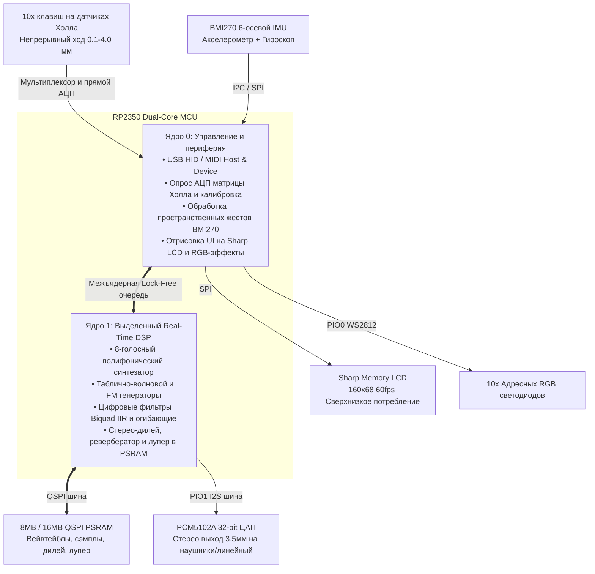

# Magneteno — Экспрессивный портативный синтезатор и MPE-контроллер на датчиках Холла

**Magneteno** — это гибридный микроинструмент, объединяющий сверхчувствительную **10-клавишную аналоговую клавиатуру на датчиках Холла**, выделенный **двухъядерный звуковой DSP-движок RP2350**, аудиофильский **I2S стерео-ЦАП PCM5102A**, скоростную **QSPI PSRAM** память для сэмплов и дилеев, 6-осевой **пространственный гироскоп/акселерометр BMI270**, сверхчеткий **Sharp Memory LCD** дисплей и **поклавишную адресную RGB-подсветку**.

Устройство может работать как **автономный портативный синтезатор / грувбокс**, так и в роли **продвинутого USB MPE (MIDI Polyphonic Expression) контроллера** для внешних DAW и плагинов.

---

## Аппаратная архитектура и распределение задач



### Сводная таблица компонентов и их ролей

| Элемент | Роль в синтезаторе |
| :--- | :--- |
| **10 клавиш на датчиках Холла** | Непрерывный аналоговый контроль (0.1–4.0 мм) и MPE:<br/>• **Velocity**: расчет скорости удара по $dx/dt$;<br/>• **Polyphonic Aftertouch**: индивидуальное открытие фильтра (VCF) и перегруз при дожатии клавиши;<br/>• **Морфинг тембра**: глубина хода плавно сканирует вейвтейбл (синус $\to$ пила $\to$ меандр);<br/>• **Rapid Trigger**: пулеметные повторные триггеры без возврата клавиши в исходное положение;<br/>• **Клавиши 9 и 10** (большие пальцы): прямой АЦП — служат экспрессивными полосами питч-бенда, сустейна или переключения октав. |
| **I2S ЦАП PCM5102A** | Высококачественный стереовыход (32-бит, 112 dB SNR):<br/>• Прямое подключение наушников 3.5 мм или колонок/микшера;<br/>• Полноценная стереопанорама для голосов полифонии, стерео-дилей и реверберация;<br/>• Синтез полностью вынесен на Core 1 процессора RP2350 — нулевой джиттер и никаких щелчков. |
| **QSPI PSRAM (8/16 МБ)** | Память для тяжелого звука и пространственных эффектов:<br/>• Хранение объемных таблиц волн (Wavetables из Serum/Vital);<br/>• Сэмплы ударных и акустических инструментов;<br/>• Буфер для длинного ленточного стерео-дилея (до 30 сек) и ревербератора (FDN);<br/>• **Live Sound-on-Sound Looper**: запись и зацикливание фраз прямо на лету с возможностью солировать поверх. |
| **6-осевой IMU BMI270** | Пространственные жесты:<br/>• **Roll** (наклон влево/вправо): гитарное вибрато или плавный питч-бенд;<br/>• **Pitch** (наклон вперед/назад): открытие/закрытие общего Low-Pass фильтра;<br/>• **Встряхивание (Shake)**: мгновенный глитч, сбивка ударных или Freeze дилея;<br/>• **Tap Tempo**: двойной стук по корпусу задает BPM секвенсора. |
| **Sharp Memory LCD** | Сверхбыстрый энергоэффективный дисплей (160x68):<br/>• Живой осциллограф синтезируемого звука (60 fps без размытия);<br/>• 10 вертикальных шкал, показывающих точный физический ход каждой клавиши в реальном времени;<br/>• Графическое отображение кривой огибающей ADSR и частоты фильтра;<br/>• Индикация пресета, лада/гаммы, BPM и октавы. |
| **10 RGB светодиодов** | Интуитивная визуальная обратная связь:<br/>• **Подсветка гамм**: тоника — синяя, аккордовые ступени — зеленые, ноты вне лада выключены (игра без фальши);<br/>• **Визуализатор хода**: переход от бирюзового к красному по мере погружения в зону послекасания;<br/>• **Бегущий огонь**: индикация текущего шага в 8/16/32-шаговом секвенсоре;<br/>• Монитор активных голосов с затуханием в фазе Release. |

---

### 1. 10 клавиш на датчиках Холла (Keys 1..10)
В отличие от обычных бинарных механических свитчей (вкл/выкл), в Magneteno используются **линейные датчики Холла** (мультиплексированные через микросхему `SN74LV4051A` + две выделенные прямые линии АЦП), измеряющие физическую глубину нажатия от **0.0 до 4.0 мм** с субмиллиметровой точностью.

* **Непрерывная MPE-модуляция**:
  * **Скорость атаки (Velocity)**: Вычисляется в реальном времени как скорость опускания клавиши ($v = \frac{dx}{dt}$) на начальном отрезке хода (0.3–1.5 мм). По времени между отсчетами АЦП вычисляется сила удара и масштабируется в диапазон MIDI `1..127` по настраиваемым кривым (Linear / Log / Exponential).
  * **Полифоническое послекасание (Polyphonic Aftertouch)**: Зона от точки срабатывания (1.5 мм) до упора (4.0 мм) непрерывно опрашивается как индивидуальное послекасание для каждого пальца:
    * **Выбор назначения (Destination)**: срез фильтра (VCF Cutoff), резонанс, сатурация/перегруз (Drive), глубина вибрато (LFO Depth), положение волновой таблицы (Wavetable Pos), питч-бенд или посыл на эффекты (FX Send).
    * **Глубина влияния (Depth)**: двуполярная шкала `-100% ... 0 ... +100%`, позволяющая при дожатии клавиши как открывать фильтр/усиливать эффект, так и мягко приглушать звук.
  * **Морфинг тембра**: Глубина хода может непрерывно переключать или смешивать формы волны (например: чистый синус на 1 мм $\to$ теплый пилообразный сигнал на 2.5 мм $\to$ агрессивный меандр на 4 мм).
* **Rapid Trigger (Быстрый триггер)**: Незаменимый инструмент для экспрессивной игры на синтезаторе:
  * В обычных клавишах для повторного извлечения ноты необходимо отпустить клавишу выше фиксированной точки сброса (1.5–2.0 мм от дна).
  * С **Rapid Trigger** точка деактивации следует за движением пальца: достаточно приподнять клавишу всего на **0.1–0.2 мм в любой точке хода** (даже у самого дна), как нота мгновенно сбрасывается и готова к повторному взятию.
  * **Преимущества для синтезатора**:
    * Скоростные трели и щипковое тремоло (мандолина, гитарный перебор, струнные).
    * Быстрые чиптюновые арпеджио руками без задержки клавиш.
    * Пулеметные роллы ударных и сбивки (например, 808 Trap Hi-Hats).
    * Повторный перезапуск огибающей (Re-articulation) без разрыва сустейна и без щелчков.
* **Многозонный триггер**:
  * *Верхняя зона (0.5 – 1.5 мм)*: Звучит основная нота.
  * *Нижняя зона (2.5 – 4.0 мм)*: Дополнительно активируется суб-осциллятор на октаву ниже или слой шума.
* **Клавиши под большие пальцы (Key 9 и Key 10)**:
  * Подключены напрямую к быстрым каналам АЦП (`ADC2` на GPIO28, `ADC1` on GPIO27).
  * Служат полосами питч-бенда (Pitch Bend), переключателями октав, педалью сустейна или модификаторами аккордов.

---

### 2. 32-битный I2S стерео-ЦАП PCM5102A
Высококачественный аудиофильский цифро-аналоговый преобразователь, подключенный через аппаратный I2S на базе блока PIO (`BCK` на GPIO6, `DATA` на GPIO7, `LRCK` на GPIO8).

* **Прямой аудиовыход**: Раскачивает наушники 3.5 мм или подключается к линейному входу микшера/колонок с соотношением сигнал/шум 112 дБ.
* **Стереопанорама**: Голоса могут автоматически распределяться по стереопанораме в зависимости от высоты ноты, LFO или наклона корпуса.
* **Синтез на Ядре 1 (Core 1 DSP)**: Весь аудиопоток синтезируется на втором ядре процессора RP2350 непосредственно из оперативной памяти (`__not_in_flash_func`), исключая любые задержки, щелчки или прерывания звука при работе USB или экрана.

---

### 3. QSPI PSRAM (8 МБ / 16 МБ)
Высокоскоростная внешняя оперативная память, подключенная по шине QSPI.

* **Банки таблично-волновых форм (Wavetables)**: Хранение детальных мультицикловых волновых таблиц (совместимых с Serum и Vital) для плавного цифрового морфинга.
* **Сэмплер и ударные (PCM Playback)**: Воспроизведение несжатых сэмплов ударных, пианино, струнных и текстур с мгновенным откликом.
* **Пространственные эффекты времени (Time-Based FX)**:
  * **Стерео-дилей**: До 30 секунд ленточного дилея с обратной связью и сатурацией.
  * **Алгоритмический ревербератор**: Буферы для многоотводной реверберации (FDN), создающие объемное акустическое пространство.
* **Живой лупер (Sound-on-Sound Looper)**: Запись фраз на лету прямо в PSRAM с наложением (overdub) и одновременным исполнением соло.

---

### 4. 6-осевой датчик движения BMI270 (Акселерометр + Гироскоп)
Превращает корпус инструмента в дополнительный экспрессивный контроллер:

* **Наклон влево/вправо (Roll)**:
  * Гитарное вибрато кистью или плавный питч-бенд ($\pm 2$ – $\pm 12$ полутонов).
* **Наклон вперед/назад (Pitch)**:
  * Управление фильтром низких частот (Low-Pass Filter) — поднимите нос инструмента вверх, чтобы открыть фильтр и сделать звук ярким, или опустите вниз для приглушенного баса.
* **Встряхивание (Shake / Jerk)**:
  * Резкое встряхивание активирует сбивку ударных, зацикливание дилея (Freeze) или глитч-эффект.
* **Tap Tempo**:
  * Двойное постукивание по корпусу автоматически задает темп встроенного секвенсора.

---

### 5. Sharp Memory LCD (LS011B7DH03 160x68 Монохромный)
Ультраэкономичный контрастный дисплей с памятью пикселей (`MOSI` на GPIO11, `SCK` на GPIO10, `CS` на GPIO9).

* **Мгновенный отклик и читаемость на солнце**: Частота обновления 60 Гц без размытия и шлейфов, потребляет микроватты энергии, не выгорает в отличие от OLED.
* **Отображаемая информация в реальном времени**:
  * **Живой осциллограф**: График формы синтезируемой волны в реальном времени.
  * **Шкала хода клавиш (10 полос)**: Отображает физическую глубину прижатия каждой из 10 клавиш.
  * **Визуализатор огибающей и фильтра**: График ADSR и кривая фильтрации.
  * **Статус инструмента**: Название пресета, текущая гамма/тональность, BPM, октава и заряд батареи.

---

### 6. 10 адресных RGB светодиодов (WS2812)
Расположены под каждым свитчем (`GPIO12`).

* **Подсветка ладов и гамм**: Тоника подсвечивается синим, ступени аккорда — зеленым, а ноты вне выбранного лада гаснут (игра без фальшивых нот).
* **Визуализация силы нажатия**: Плавный переход цвета от бирюзового $\to$ зеленого $\to$ янтарно-красного по мере углубления в зону послекасания.
* **Бегущий огонь секвенсора**: Индикация текущего шага в 8- или 16-шаговом паттерне.
* **Индикатор голосов полифонии**: Наглядное отображение активных голосов с затуханием в фазе Release.

---

### 7. CMSIS-DSP и математический движок RP2350 (Core 1 DSP)
Процессор RP2350 построен на ядрах **ARM Cortex-M33** с расширением ARMv8-M DSP и аппаратным блоком одинарной точности **FPU** (Single-Precision Floating Point). 

Для обеспечения бескомпромиссного студийного качества звука и максимальной производительности аудиоядро синтезатора задействует библиотеку **CMSIS-DSP** (`arm_math.h`):
* **Каскадные IIR-фильтры (`arm_biquad_cascade_df1_f32`)**: Цифровые фильтры низких, высоких и полосовых частот (LP/HP/BP/Notch) рассчитываются во float32. Это полностью устраняет шумы округления фиксированной точки, переполнение разрядной сетки и щелчки при резкой модуляции частоты среза.
* **Быстрое преобразование Фурье (`arm_rfft_fast_f32`)**: Вещественное 128/256-точечное FFT выполняется за доли миллисекунды, питая спектроанализатор на дисплее Sharp LCD на стабильных 60 кадрах в секунду.
* **Векторные операции микширования (`arm_scale_f32`, `arm_mult_f32`, `arm_add_f32`)**: Параллельное сложение и масштабирование 8 аудиопотоков без задержек и циклов на чистом векторном ассемблере.
* **Быстрая тригонометрия (`arm_sin_f32`, `arm_cos_f32`, `arm_sqrt_f32`)**: Высокоточные таблично-интерполированные генераторы волн осцилляторов и низкочастотных модуляторов (LFO) с компенсацией алиасинга.

---

---

## Система навигации и управления интерфейсом

Интерфейс Magneteno построен на интуитивной концепции:
* **Одновременное нажатие клавиш 9 + 10 из любого режима**: Немедленный возврат в **Главное Меню** (Global Menu).
* **Клавиши 1..8**: Функциональные регуляторы параметров, выбор слотов, шагов или нот.
* **Клавиши 9 и 10**: Служебные кнопки навигации — переключение страниц параметров, банков/слотов (A/B), режимов (Save/Load, Play/Stop).

| Колонка 1 | Колонка 2 | Колонка 3 | Колонка 4 | Колонка 5 |
| :---: | :---: | :---: | :---: | :---: |
| **[1] Осцилляторы**<br/>(OSC) | **[2] Фильтры**<br/>(VCF) | **[3] Огибающие**<br/>(EG / ADSR) | **[4] LFO**<br/>(Модуляция) | |
| **[5] Advanced**<br/>(MPE, Legato) | **[6] Пресеты**<br/>(Save / Load) | **[7] Эффекты**<br/>(FX Engine) | **[8] 8-кан. микшер**<br/>(Mixer) | |
| | | | **[9] Режим пианино**<br/>(Piano Play) | **[10] Секвенсер**<br/>(Step Seq) |

---

### Режимы исполнения и секвенции

#### [9] Режим пианино (Piano / Performance Mode)

| Колонка 1 | Колонка 2 | Колонка 3 | Колонка 4 | Колонка 5 |
| :---: | :---: | :---: | :---: | :---: |
| **[1] Нота 1**<br/>(Ступень I) | **[2] Нота 2**<br/>(Ступень II) | **[3] Нота 3**<br/>(Ступень III) | **[4] Нота 4**<br/>(Ступень IV) | |
| **[5] Нота 5**<br/>(Ступень V) | **[6] Нота 6**<br/>(Ступень VI) | **[7] Нота 7**<br/>(Ступень VII) | **[8] Нота 8**<br/>(Октава / VIII) | |
| | | | **[9] Октава - / Питч-**<br/>(Pitch / Oct Down) | **[10] Октава + / Питч+**<br/>(Pitch Up / Hold) |

*Клавиши 1..8 имеют непрерывный аналоговый опрос: глубина нажатия передает полифоническое послекасание (Aftertouch) и Velocity.*

#### [10] Секвенсер (Step Sequencer)

32-шаговый секвенсер с 4 страницами по 8 шагов и индивидуальными параметрами синтезатора для каждой из 8 дорожек:

| Колонка 1 | Колонка 2 | Колонка 3 | Колонка 4 | Колонка 5 |
| :---: | :---: | :---: | :---: | :---: |
| **[1] Шаг 1 / 9 / 17 / 25**<br/>(Вкл / Mute) | **[2] Шаг 2 / 10 / 18 / 26**<br/>(Вкл / Mute) | **[3] Шаг 3 / 11 / 19 / 27**<br/>(Вкл / Mute) | **[4] Шаг 4 / 12 / 20 / 28**<br/>(Вкл / Mute) | |
| **[5] Шаг 5 / 13 / 21 / 29**<br/>(Вкл / Mute) | **[6] Шаг 6 / 14 / 22 / 30**<br/>(Вкл / Mute) | **[7] Шаг 7 / 15 / 23 / 31**<br/>(Вкл / Mute) | **[8] Шаг 8 / 16 / 24 / 32**<br/>(Вкл / Mute) | |
| | | | **[9] Запись / Шаг**<br/>(Rec / Step) | **[10] Стр. 1-4**<br/>(Стр. 1..4 / 32 шага) |

*Управление секвенсером:*
* **Одиночное нажатие [1..8]**: быстрое переключение состояния шага (активен / Mute).
* **Клавиша [10]**: переключение страниц шагов (Стр. 1: 1–8, Стр. 2: 9–16, Стр. 3: 17–24, Стр. 4: 25–32).
* **Клавиша [9]**: переключение режима записи (Rec / Play).
* **Комбинация [9 + 10]**: глобальный Пуск / Стоп воспроизведения секвенсера (Transport Play/Stop).
* **Комбинация [9 + 1..8] (Режим редактирования шага / Step Edit Mode)**:
  * Так как на 10-кнопочном устройстве невозможно одновременно физически удерживать шаг и крутить другие параметры, комбинация `9 + [1..8]` активирует выбранный шаг для редактирования (шаг начинает пульсировать на экране и подсветке).
  * **Запись ноты**: при активном шаге в **Режиме пианино [9]** (или по USB MIDI) играется нота/аккорд с фиксацией физической силы удара (Velocity) и длительности.
  * **Параметр-локи (Parameter Locks)**: находясь в режиме редактирования шага, можно открывать любые вкладки синтезатора `[1..7]` и настраивать параметры (срез фильтра VCF, огибающие, вейвтейбл, посыл на Delay/Reverb) — все измененные регуляторы автоматически сохраняются исключительно для этого шага!
  * Повторное нажатие `[9]` завершает редактирование шага и возвращает в стандартный режим секвенсера.
* **Комбинация [9 + 10 + 1..8]**: выбор шага остановки / длины паттерна на текущей странице (от 1 до 32 шагов), по достижении которого секвенсер немедленно возвращается к первому шагу.

---

### [8] 8-канальный микшер и лупер (Mixer & Looper)

Микшер и 8-дорожечный лупер в PSRAM тесно интегрированы с движком секвенсера:
* Каждая дорожка обладает собственным независимым набором параметров синтезатора (осцилляторы, фильтр, огибающие, эффекты).
* **Клавиша 10**: циклически переключает банки каналов: **Банк A (Каналы 1–4)** и **Банк B (Каналы 5–8)**.
* **Клавиша 9**: переключает отображение между **Режимом фейдеров микшера** и **Режимом управления лупером (Looper Control)**.
* Выбор дорожки (`[1..4]` в режиме лупера) автоматически открывает **Секвенсер этой дорожки** для пошаговой записи или редактирования.

#### Режим фейдеров микшера (Mixer Faders)

| Колонка 1 | Колонка 2 | Колонка 3 | Колонка 4 | Колонка 5 |
| :---: | :---: | :---: | :---: | :---: |
| **[1] Канал 1 / 5**<br/>Громкость `[+]` | **[2] Канал 2 / 6**<br/>Громкость `[+]` | **[3] Канал 3 / 7**<br/>Громкость `[+]` | **[4] Канал 4 / 8**<br/>Громкость `[+]` | |
| **[5] Канал 1 / 5**<br/>Громкость `[-]` | **[6] Канал 2 / 6**<br/>Громкость `[-]` | **[7] Канал 3 / 7**<br/>Громкость `[-]` | **[8] Канал 4 / 8**<br/>Громкость `[-]` | |
| | | | **[9] Лупер (Looper)**<br/>(Экран записи) | **[10] Банк A / B**<br/>(Ch 1-4 / 5-8) |

*Удержание клавиш переключает контекст: Volume (громкость) / Pan (панорама) / Mute (заглушить).*

#### Режим управления 8-дорожечным лупером (Looper Control)

| Колонка 1 | Колонка 2 | Колонка 3 | Колонка 4 | Колонка 5 |
| :---: | :---: | :---: | :---: | :---: |
| **[1] Дорожка 1 / 5**<br/>Секвенсер / Rec | **[2] Дорожка 2 / 6**<br/>Секвенсер / Rec | **[3] Дорожка 3 / 7**<br/>Секвенсер / Rec | **[4] Дорожка 4 / 8**<br/>Секвенсер / Rec | |
| **[5] Дорожка 1 / 5**<br/>Mute / Clear | **[6] Дорожка 2 / 6**<br/>Mute / Clear | **[7] Дорожка 3 / 7**<br/>Mute / Clear | **[8] Дорожка 4 / 8**<br/>Mute / Clear | |
| | | | **[9] Микшер (Mixer)**<br/>(Экран фейдеров) | **[10] Банк A / B**<br/>(Тр 1-4 / 5-8) |

#### Гибридная архитектура синтеза и лупера:
* **Текущий активный голос — Real-Time DSP**: Выбранный для игры или редактирования трек синтезируется в реальном времени на ядре Core 1 со всеми нюансами полифонии, MPE-модуляцией от датчиков Холла, жестами IMU и параметр-локами.
* **Фоновые дорожки — аудиолупы в PSRAM**: Фоновые партии воспроизводятся как аудиодорожки (PCM 16-бит 44.1 кГц) прямо из памяти PSRAM. Воспроизведение 7 параллельных аудиопотоков из PSRAM требует менее 0.6 МБ/с (менее 5% пропускной способности шины Dual SPI 50 МГц) и практически 0% ресурсов CPU, освобождая вычислительную мощность RP2350 для активного соло и эффектов.
* **Память PSRAM для эффектов (FX Memory)**: Помимо аудиолупов, свободные блоки PSRAM выделяются под длинные кольцевые буферы: стереофонический ленточный дилей (до 30 секунд с модуляцией времени) и многоотводный диффузный ревербератор (FDN Reverb).

#### Способы записи и интеграции:
1. **Выбор дорожки и секвенсирование**: Нажатие клавиши `[1..4]` в лупере открывает Секвенсер соответствующей дорожки с собственными настройками синтезатора.
2. **Шаговая запись из Режима пианино и USB MIDI**: Комбинация `[9 + 1..8]` активирует запись шага и открывает Режим пианино [9], позволяя сыграть ноту/аккорд с аналоговой клавиши Холла или передать по USB MIDI.
3. **Параметр-локи (Parameter Locks)**: На каждом шаге можно зафиксировать уникальные значения параметров синтезатора (например, открыть фильтр только на 5-м шаге или сменить волну на 13-м).
4. **Запекание в аудио (Bounce to Audio Loop)**: Готовую секвенцию можно за один проход отрендерить в аудиотрек PSRAM, освободив полифонический движок для нового инструмента.
5. **Sound-on-Sound Overdub (Наложение)**: Повторная запись поверх играющего лупа без стирания ранее записанного материала.
6. **Mute / Clear**: Клавиши 5..8 глушат трек, а долгое удержание очищает аудиобуфер в PSRAM и сбрасывает секвенсер дорожки.

---

### Режимы редактирования синтезатора (Меню 1–7)

#### [1] Настройка осцилляторов (Oscillators)

| Колонка 1 | Колонка 2 | Колонка 3 | Колонка 4 | Колонка 5 |
| :---: | :---: | :---: | :---: | :---: |
| **[1] Форма OSC 1**<br/>(Sine/Saw/Square) | **[2] Форма OSC 2**<br/>(Waveform) | **[3] Микс OSC 1/2**<br/>(Mix Balance) | **[4] Высота OSC 2**<br/>(Coarse Semi) | |
| **[5] Расстройка**<br/>(Fine Detune) | **[6] Суб-осциллятор**<br/>(Sub Level) | **[7] Генератор шума**<br/>(Noise Level) | **[8] Hard Sync**<br/>(Синхронизация) | |
| | | | **[9] Стр. 1: Basic**<br/>(Основные) | **[10] Стр. 2: Wave**<br/>(Таблицы PSRAM) |

#### [2] Фильтры (VCF)

| Колонка 1 | Колонка 2 | Колонка 3 | Колонка 4 | Колонка 5 |
| :---: | :---: | :---: | :---: | :---: |
| **[1] Тип фильтра**<br/>(LP/BP/HP/Notch) | **[2] Частота среза**<br/>(Cutoff 20Hz-20k) | **[3] Резонанс**<br/>(Q-Factor) | **[4] Перегруз**<br/>(Drive / Saturation) | |
| **[5] Трекинг клав.**<br/>(Key Tracking) | **[6] Модуляция EG**<br/>(Env Depth) | **[7] Модуляция Холла**<br/>(Hall $\to$ Cutoff) | **[8] Модуляция IMU**<br/>(Tilt $\to$ Cutoff) | |
| | | | **[9] Профиль A**<br/>(Analog Ladder) | **[10] Профиль B**<br/>(Modern Clean) |

#### [3] Огибающие (Envelopes: Amp & Filter EG)

| Колонка 1 | Колонка 2 | Колонка 3 | Колонка 4 | Колонка 5 |
| :---: | :---: | :---: | :---: | :---: |
| **[1] Amp Attack**<br/>(Атака громкости) | **[2] Amp Decay**<br/>(Спад громкости) | **[3] Amp Sustain**<br/>(Сустейн громк.) | **[4] Amp Release**<br/>(Затухание громк.) | |
| **[5] Filt Attack**<br/>(Атака фильтра) | **[6] Filt Decay**<br/>(Спад фильтра) | **[7] Filt Sustain**<br/>(Сустейн фильтра) | **[8] Filt Release**<br/>(Затухание фильтра)| |
| | | | **[9] Стр. 1**<br/>(Amp / Filter EG) | **[10] Стр. 2**<br/>(Pitch / Mod EG) |

#### [4] LFO Модуляция

| Колонка 1 | Колонка 2 | Колонка 3 | Колонка 4 | Колонка 5 |
| :---: | :---: | :---: | :---: | :---: |
| **[1] Форма LFO 1**<br/>(Sine/Saw/S&H) | **[2] Скорость LFO 1**<br/>(Rate 0.1-50Hz) | **[3] Цель LFO 1**<br/>(Pitch/Cutoff/Pan) | **[4] Глубина LFO 1**<br/>(Depth) | |
| **[5] Форма LFO 2**<br/>(Waveform) | **[6] Скорость LFO 2**<br/>(Rate) | **[7] Цель LFO 2**<br/>(Destination) | **[8] Глубина LFO 2**<br/>(Depth) | |
| | | | **[9] Free Run**<br/>(Гц / Независимо) | **[10] BPM Sync**<br/>(Темпо-синхронизация) |

#### [5] Advanced (Продвинутые параметры экспрессии)

| Колонка 1 | Колонка 2 | Колонка 3 | Колонка 4 | Колонка 5 |
| :---: | :---: | :---: | :---: | :---: |
| **[1] Полифония**<br/>(Poly/Mono/Legato) | **[2] Глайд / Порт.**<br/>(Glide Time) | **[3] Цель Aftertouch**<br/>(VCF/Drive/LFO/WT) | **[4] Глубина Aftertouch**<br/>(Depth -100..+100%) | |
| **[5] Маппинг IMU**<br/>(Roll/Pitch/Shake) | **[6] Выбор лада**<br/>(Мажор/Минор/Пента)| **[7] Тональность**<br/>(Root Key: C..B) | **[8] Rapid Trigger**<br/>(Порог 0.1-1.0 мм) | |
| | | | **[9] Стр. 1: Perf**<br/>(Исполнение) | **[10] Стр. 2: Calib**<br/>(Калибровка АЦП) |

#### [6] Пресеты (Save & Load Presets)

| Колонка 1 | Колонка 2 | Колонка 3 | Колонка 4 | Колонка 5 |
| :---: | :---: | :---: | :---: | :---: |
| **[1] Слот 1**<br/>(Preset 1) | **[2] Слот 2**<br/>(Preset 2) | **[3] Слот 3**<br/>(Preset 3) | **[4] Слот 4**<br/>(Preset 4) | |
| **[5] Слот 5**<br/>(Preset 5) | **[6] Слот 6**<br/>(Preset 6) | **[7] Слот 7**<br/>(Preset 7) | **[8] Слот 8**<br/>(Preset 8) | |
| | | | **[9] Сохранить**<br/>(Save $\to$ Слот 1-8) | **[10] Загрузить**<br/>(Load $\leftarrow$ Слот 1-8)|

*Удержание клавиш 9+10 сбрасывает текущий пресет к заводским настройкам (Init Patch).*

#### [7] Эффекты (FX Engine)

| Колонка 1 | Колонка 2 | Колонка 3 | Колонка 4 | Колонка 5 |
| :---: | :---: | :---: | :---: | :---: |
| **[1] Алгоритм дилея**<br/>(Tape/Ping-Pong) | **[2] Время дилея**<br/>(Time / Sync Div) | **[3] Фидбек**<br/>(Delay Feedback) | **[4] Микс дилея**<br/>(Delay Dry/Wet) | |
| **[5] Размер реверба**<br/>(Room Size в PSRAM) | **[6] Демпфирование**<br/>(Reverb Damping) | **[7] Микс реверба**<br/>(Reverb Dry/Wet) | **[8] Сатуратор**<br/>(Soft Limiter/Drive) | |
| | | | **[9] Стр. 1: Dly/Rev**<br/>(Дилей / Реверб) | **[10] Стр. 2: Mod**<br/>(Chorus/Flanger) |

---

---

## Движки синтеза

| Движок | Принцип работы | Роль датчиков Холла и IMU |
| :--- | :--- | :--- |
| **Virtual Analog** | 2 осциллятора (Saw, Square, Triangle, Sine), синхронизация (Hard Sync) и суб-осциллятор. | Глубина хода управляет шириной импульса (PWM) и перегрузом фильтра. |
| **Wavetable Morph** | Волновые таблицы по 256 сэмплов из PSRAM с интерполяцией. | Ход клавиши плавно сканирует волновые таблицы; наклон регулирует фильтр. |
| **FM Синтез** | 2- или 4-операторный фазовый синтез для металлических, колокольных и электропиано тембров. | Скорость удара задает индекс модуляции; послекасание управляет фидбеком. |
| **Karplus-Strong** | Физическое моделирование струнных инструментов. | Сила удара задает жесткость медиатора; глубина нажатия глушит струну. |
| **Лупер и Сэмплер** | Многослойный лупер фраз и сэмплер ударных в PSRAM. | Клавиши под большой палец управляют записью/наложением, остальные играют биты. |

---

## Сводная таблица распиновки

| Компонент | Сигнал | GPIO (RP2040 / RP2350) | Назначение |
| :--- | :--- | :--- | :--- |
| **Мультиплексор SN74LV4051A** | S0, S1, S2 | GPIO15, GPIO14, GPIO13 | 3-битный адрес канала для клавиш 1..8 |
| **Датчики Холла (1..8)** | MUX ADC Out | GPIO29 (ADC3) | Аналоговый сигнал с выхода мультиплексора |
| **Клавиша Холла 9** | Direct ADC | GPIO28 (ADC2) | Прямой аналоговый вход левого большого пальца |
| **Клавиша Холла 10**| Direct ADC | GPIO27 (ADC1) | Прямой аналоговый вход правого большого пальца |
| **ЦАП PCM5102A** | BCK, DATA, LRCK | GPIO6, GPIO7, GPIO8 | Тактовый сигнал, данные и строб I2S 32-бит |
| **Sharp Memory LCD** | MOSI, SCK, CS | GPIO11, GPIO10, GPIO9 | Высокоскоростной SPI интерфейс экрана |
| **RGB светодиоды** | Data In | GPIO12 | Линия передачи данных WS2812 (10 диодов) |
| **IMU BMI270** | SDA / SCL (или SPI)| GPIO4, GPIO5 (I2C0) | 6-осевой гироскоп и акселерометр |
| **QSPI PSRAM** | CS, SCLK, D0-D3 | Выделенная шина QSPI | Внешняя память 8/16 МБ для аудио |

---

## Сборка прошивки

Для компиляции прошивки Magneteno под процессор RP2350:

```bash
# Чистая сборка прошивки Magneteno на RP2350 с выводом в .uf2
./build_all.sh -c -b magneteno --mcu rp2350 --uf2
```

Файл `build/dmk_magneteno_rp2350.uf2` готов для прошивки через BOOTSEL. Подключите наушники в разъем 3.5 мм и наслаждайтесь беспрецедентной тактильной и звуковой экспрессией!
